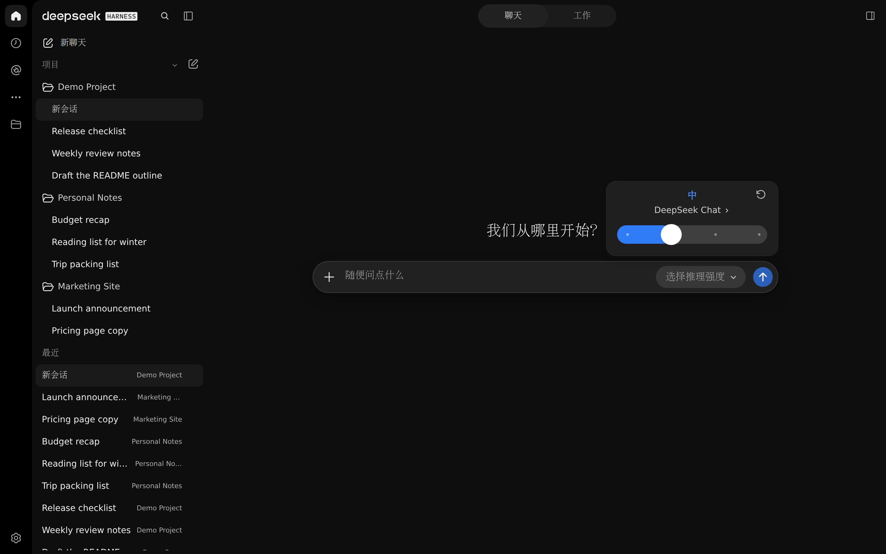
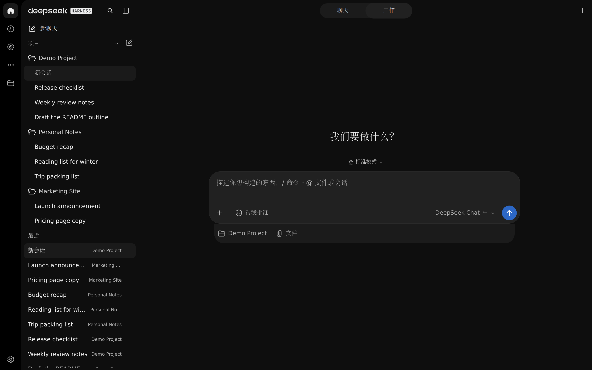
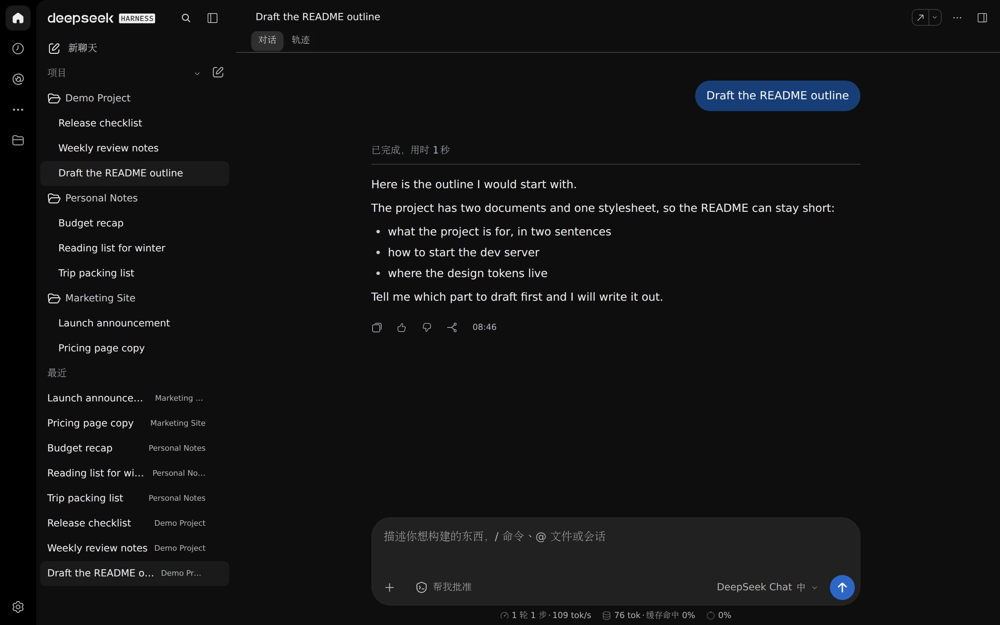
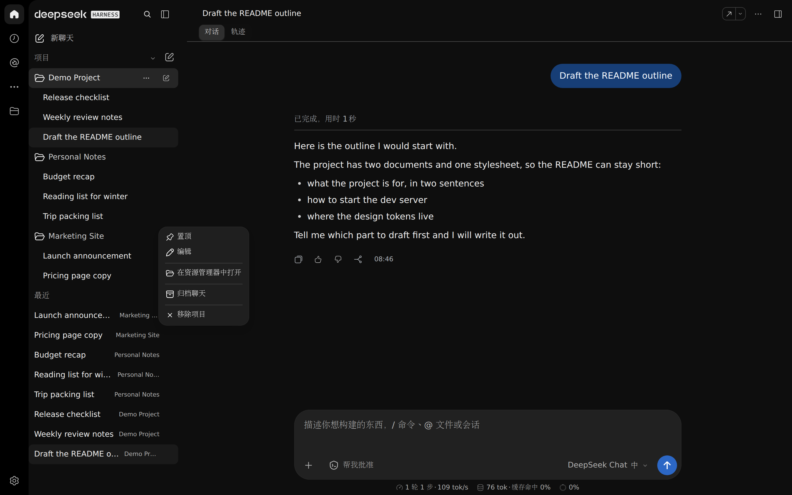

# dsh-chatgpt-ui

ChatGPT 桌面版风格的 DSH Web GUI 皮肤：只换外观，不动行为——装与不装插件，
任务/目标、执行步骤、文件与输出聚合、折叠面板全部原样保留。



## 亮点

- **保留 DSH 原生能力。** 任务与目标、执行步骤、文件/输出聚合、折叠面板、`/` 命令、
  `@` 引用、搜索、附件与代码块都走宿主原装组件，皮肤只做视觉适配；像素级回归闸门
  对比「装/不装插件」两套界面，行为必须一致。
- **super-agent 适配（dot 品牌位）。** 侧栏 `新聊天` 下方保留 super-agent 入口与未读
  徽标；Router / worker 的内部会话不进「最近」也不进项目段，只剩内部会话的项目组隐藏。
- **高还原度。** 以 ChatGPT 桌面版截图为准逐像素对照（配色、侧栏 340、消息列 768、
  卡片 26px 圆角、分段 224×36、滑块 252×36），网页版只用来补图标与实测间距；
  尚未对齐的差异记录在 [已知限制](docs/limitations.md)。
- **作用域收口的样式。** 每条规则都以 `body[data-chatgpt-ui]` 开头，暗色只挂在
  `data-ds-dark-theme` 上；卸载走 `ctx.effect` 的 disposer，`<style>`、令牌层与面板
  一起消失，不刷新页面。`data-cgpt-skin="off"` 可让宿主回到「没装插件」的样子。

## 安装与启用

```sh
dsh plugin --profile web add /path/to/dsh-chatgpt-ui
```

1. 重启 `dsh web`（patch 层只在启动时展开），然后硬刷新浏览器页面；
2. 控制台出现 `[dsh-chatgpt-ui] v0.1.0 mounted …`、`<body>` 上有
   `data-chatgpt-ui="0.1.0"` 即为生效；
3. 卸载：`dsh plugin --profile web remove dsh-chatgpt-ui`，重启后浏览器半部的标记、
   样式与令牌还原。

首次使用请看 [开发说明](docs/development.md)，出问题看 [排障](docs/troubleshooting.md)。

## 截图

1440×900 @2x，深色；演示数据（`Demo Project` / `Personal Notes` / `Marketing Site`）来自临时隔离实例，统一为英文，不含任何真实项目、会话或路径。

| Chat 空态 · 推理强度滑块 | Work 空态 · 新建会话 |
| --- | --- |
|  |  |
| 空态标题 `我们从哪里开始?`，模型药丸展开推理强度滑块：面板贴在卡片上方、不遮挡输入卡，拖动切换档位。 | 输入卡、已选项目 `Demo Project`、`帮我批准` 权限按钮与底部 `项目 · 文件` 一行。 |

| 既有会话 · 消息与输入卡 | 侧栏细节 · 项目菜单 |
| --- | --- |
|  |  |
| 用户气泡、助手正文与原生「已完成」步骤行，下方是贴底输入卡。 | 项目行悬停出现 `⋯`，菜单为置顶/编辑/在资源管理器中打开/归档/移除。 |

## 开发与验收

```sh
npm run build       # 拼接片段 + CSS → lib/client.js（提交产物）
npm run check:core  # 语法门禁，任何 clone 都能跑
npm run test:core   # 契约 / 纯函数 / 样式作用域，无需本机证据
npm test            # 全量：额外重放 docs/ 下的本机采集证据
npm run matrix -- --url "http://127.0.0.1:3104/?token=…" --playwright …
```

`npm test` 与 `npm run check` 的后半段依赖本机采集的证据（真实会话标题与路径都在里面，
因此不入库）。干净 clone 请先跑 `check:core` + `test:core`，证据的采集与取舍见
[测试与验收](docs/testing.md)。

## 文档

| 文档 | 内容 |
| --- | --- |
| [架构](docs/architecture.md) | 插件结构、槽位注入、样式作用域、选择器契约 |
| [样式令牌](docs/design-tokens.md) | 颜色、圆角、字号、间距与几何令牌表 |
| [测试与验收](docs/testing.md) | `npm test` / `npm run check` / `npm run matrix`、回归闸门、截图复跑 |
| [路线图](docs/roadmap.md) · [已知限制](docs/limitations.md) | 还差什么、为什么先不做 |
| [开发](docs/development.md) · [排障](docs/troubleshooting.md) | 构建、目录约定、常见问题 |
| [变更日志](CHANGELOG.md) | 已完成的模块，倒序 |

## About

> A ChatGPT-desktop skin for the DSH Web GUI: Chat and Work modes, project/session sidebar, pixel-matched composer and messages, light and dark. Native DSH features — steps, tasks, goals, file outputs — stay intact with or without the skin.

卖点拆解与使用场景见 [docs/about.md](docs/about.md)。

## License

[MIT](LICENSE) © 2026 Tianze Luo

## 声明

- 本项目**不是** OpenAI 官方项目，与 OpenAI 无隶属或授权关系；「ChatGPT」仅用于说明
  视觉参考对象，相关商标归其所有者。
- 界面素材（图标字形、实测间距与配色）取自维护者本机 ChatGPT 网页版/桌面版的**只读**
  观察，仅用于复刻布局与配色；仓库不包含 OpenAI 的源代码或专有资源。
- 仓库不含任何真实会话、项目数据、凭据或用户路径；演示截图在临时隔离实例中生成。
